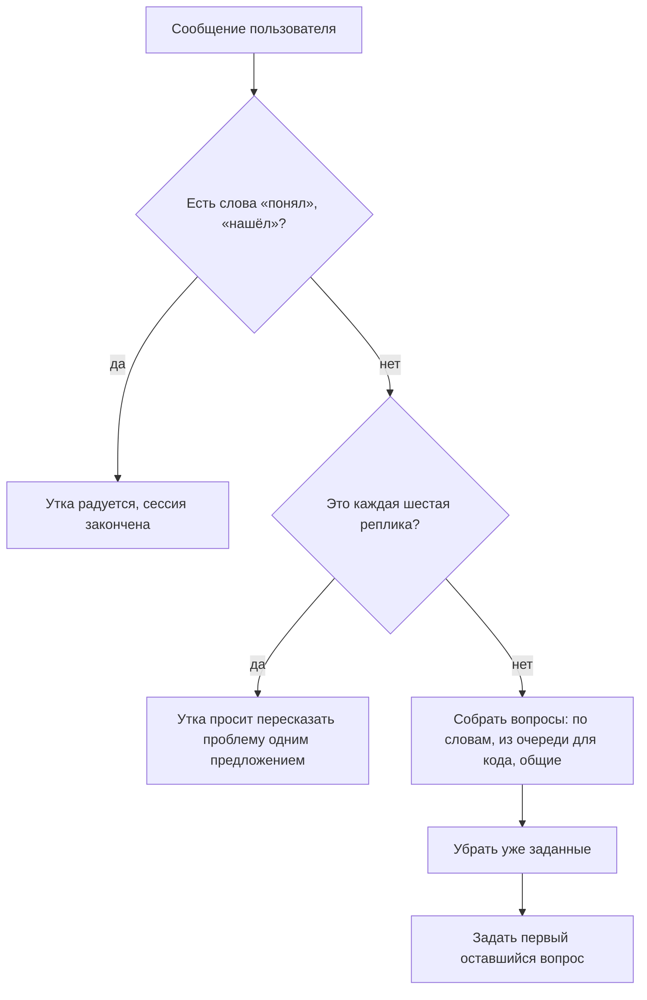

# Отчёт по лабораторной работе: плагин для VS Code

**Выполнил:** Кузьмин Иван Романович, группа M3118
**Репозиторий:** https://github.com/wylonguniverse/rubber-duck

## Цель работы

Разобраться, как к IDE подключаются сторонние плагины, и сделать свой плагин для Visual Studio Code.

## Как VS Code работает с плагинами

VS Code написан на Electron, поэтому он состоит из нескольких процессов. Главный процесс отвечает за окна. Отдельный процесс рисует сам интерфейс: редактор, панели, меню. А плагины запускаются в ещё одном процессе, который называется Extension Host (это обычный Node.js). Благодаря этому, если плагин завис, сам редактор продолжает работать.

Плагин не может напрямую менять интерфейс. Он общается с VS Code через специальное API, то есть через модуль `vscode`. С его помощью можно, например, узнать, какой файл открыт, какой текст выделен, какие в файле есть ошибки, добавить свою команду или подсветить строку.

Что плагин добавляет в IDE, описывается в файле `package.json` в разделе `contributes`. Там перечисляются команды, пункты меню, боковые панели и настройки. VS Code читает этот файл и показывает команды и панели, не запуская код плагина. Сам код запускается позже, когда пользователь первый раз что-то вызвал (например, команду). Тогда выполняется функция `activate()`, в которой плагин регистрирует свои обработчики.

Для более сложного интерфейса есть Webview. Это маленькая веб-страница (HTML, CSS и JavaScript) внутри VS Code. Она изолирована от кода плагина, поэтому страница и плагин обмениваются сообщениями через `postMessage`.

Готовый плагин упаковывается командой `vsce package` в файл `.vsix`, который можно установить в VS Code.

## Что делает мой плагин

Плагин называется **Rubber Duck Debugger**. Он основан на методу «резиновой утки»: если объяснить проблему вслух кому-то (даже игрушке), решение часто находится само. В боковой панели появляется чат с уткой. Утка не решает задачу за пользователя, а задаёт вопросы.

Что умеет плагин:

- Чат с уткой в боковой панели. Утка отвечает вопросами, которые подбираются по словам в сообщении (например, `undefined`, «цикл», `async`, «массив», «ошибка»). Вопросы не повторяются.
- Разбор выделенного кода. Нужно выделить код и нажать кнопку или пункт контекстного меню. Утка подсветит эти строки и задаст вопросы про то, что в коде есть (функции, циклы, условия, `try/catch` и так далее).
- Разбор ошибок файла. Плагин читает ошибки и предупреждения текущего файла, подсвечивает строку и спрашивает, почему возникла ошибка. Повторное нажатие переходит к следующей.
- Если написать «понял» или «нашёл», утка завершает сессию.
- В настройках можно поменять имя утки.

## Как устроен плагин

Файлы проекта:

- `package.json`: описание плагина, панель, команды, меню, настройки;
- `src/extension.ts`: функция `activate()`, где регистрируются панель и команды;
- `src/duckViewProvider.ts`: панель с чатом, обмен сообщениями с Webview, история чата;
- `src/editorContext.ts`: чтение выделенного кода и ошибок, подсветка строк;
- `src/questionEngine.ts`: правила и выбор вопросов;
- `media/chat.js` и `media/chat.css`: интерфейс чата внутри Webview.

Что я использовал из `package.json`:

- `viewsContainers` и `views`: значок утки слева и сама панель;
- `commands`: четыре команды (начать сессию, объяснить код, спросить про ошибки, новая сессия);
- `menus`: пункт в контекстном меню редактора и кнопка в заголовке панели;
- `configuration`: настройка с именем утки.

Какие функции API использовал:

- `registerWebviewViewProvider`: подключить чат в боковую панель;
- `registerCommand`: регистрация команд;
- `activeTextEditor`, `selection`, `getText`: получить выделенный код;
- `languages.getDiagnostics`: получить ошибки файла;
- `createTextEditorDecorationType` и `setDecorations`: подсветить строки;
- `onDidChangeTextDocument`: снять подсветку, когда файл правят;
- `getConfiguration`: прочитать имя утки;
- `postMessage` и `onDidReceiveMessage`: обмен сообщениями с Webview.

Логику выбора вопросов я вынес в отдельный файл `questionEngine.ts`, который вообще не использует `vscode`. Так её проще проверять отдельно от редактора. Ответ утки выбирается так:



Webview работает под Content Security Policy, поэтому скрипт подключается с `nonce`, а текст пользователя вставляется в страницу только как текст, не как HTML. Цвета в интерфейсе берутся из переменных темы VS Code, так что чат подходит и под светлую, и под тёмную тему.

### Что было сложно

Самым неприятным оказался интерфейс чата. Сначала сообщения утки отображались узкими столбиками, а потом налезали друг на друга. Причина была в CSS: у картинки утки в шапке и у сообщений утки одинаковое имя класса `duck`, поэтому размеры картинки (44 на 44 пикселя) применялись ещё и к сообщениям. Я ограничил стили для шапки только самой картинкой, и всё стало нормально.

## Как запустить

Нужны Node.js и VS Code. В папке проекта:

```bash
npm install
npm run compile
```

Потом открыть папку в VS Code и нажать F5 (или Run → Start Debugging). Откроется второе окно, в котором плагин уже подключён.

Чтобы установить плагин в обычный VS Code, нужно собрать пакет:

```bash
npx @vscode/vsce package
```

и установить получившийся `.vsix`: вкладка расширений → `…` → Install from VSIX.

## Вывод

В работе я разобрался, как устроены плагины в VS Code: они выполняются в отдельном процессе Extension Host и работают с IDE через API, а их возможности описываются в `package.json`. Я сделал свой плагин с чатом в боковой панели, который умеет читать выделенный код и ошибки файла, подсвечивать строки и хранить настройки. Плагин упаковывается в `.vsix`, исходный код и документация лежат в репозитории на GitHub.

## Источники

1. Документация VS Code Extension API: https://code.visualstudio.com/api
2. Contribution Points: https://code.visualstudio.com/api/references/contribution-points
3. Webview API: https://code.visualstudio.com/api/extension-guides/webview
